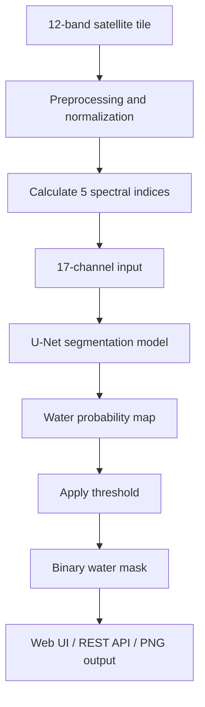

# 🌊 Water Segmentation from Multispectral Satellite Imagery

A deep-learning project for detecting water bodies in multispectral satellite imagery using a **17-channel U-Net**. The project includes a model inference pipeline, a Flask REST API, and an interactive web interface for visualizing predicted water masks.

Upload a 12-band satellite tile, run water segmentation, and compare the predicted water mask with the original true-colour image.

> **Model status:** The repository's checkpoint may be a synthetic-data demo model. Synthetic data are useful for testing the application pipeline, but they do not establish real-world water-detection accuracy. See [Model Performance and Limitations](#-model-performance-and-limitations) before interpreting predictions.

---

## ✨ Features

- **Multispectral input:** Supports 12-band GeoTIFF satellite tiles and NumPy arrays.
- **Spectral feature engineering:** Adds five water- and vegetation-related indices to the original 12 bands.
- **Deep-learning segmentation:** Uses a U-Net architecture to classify pixels as water or non-water.
- **Interactive web interface:** Upload tiles and visualize segmentation results.
- **REST API:** Run predictions programmatically through Flask.
- **Prediction visualization:** Generate binary masks, true-colour previews, overlays, and probability maps.
- **Test-time augmentation:** Optionally averages predictions from eight rotations and flips.
- **Automated testing:** Includes API checks, edge cases, and optional evaluation against reference masks.

## 🛰️ How It Works

The pipeline transforms each satellite tile into a multichannel input, predicts water probabilities, and converts those probabilities into a binary mask.



### Input and output

| Property | Description |
|---|---|
| Input | 12-band multispectral satellite imagery |
| Training tile size | 128 × 128 pixels |
| Derived features | NDWI, MNDWI, NDVI, AWEInsh, AWEIsh |
| Model input | 17 channels |
| Output | Binary water segmentation mask |
| Mask values | `0` = non-water, `255` = predicted water |
| Inference framework | PyTorch |
| Web framework | Flask |

The input dimensions supported by the inference pipeline depend on its preprocessing and model implementation; 128 × 128 pixels is the training tile size.

## 🧠 Model Architecture

The deployed architecture is a U-Net segmentation model. U-Net uses an encoder-decoder structure with skip connections to combine high-level image features with spatial details.

The model receives:

- **12 original spectral bands**
- **5 derived spectral indices**

These features are combined into a 17-channel tensor. The checkpoint also stores the channel-normalization statistics used during inference.

### Spectral indices

| Index | Purpose |
|---|---|
| NDWI | Highlights water using green and near-infrared reflectance |
| MNDWI | Enhances water detection using green and shortwave-infrared reflectance |
| NDVI | Helps distinguish vegetation from other land-cover types |
| AWEInsh | Water-enhancement index designed to reduce shadow interference |
| AWEIsh | Water-enhancement index designed for shadow-prone conditions |

**Important:** The index calculations assume the input bands are mapped correctly to the required wavelengths. Confirm that the band order and reflectance scaling match the training pipeline before using imagery from a different satellite or dataset.

## 📊 Model Performance and Limitations

The Week 1–2 model comparison reported the following out-of-fold cross-validation results:

| Model configuration | Input channels | IoU | F1 |
|---|---:|---:|---:|
| U-Net from scratch + water indices | 17 | 0.7102 | 0.8306 |
| U-Net with ResNet34, random initialization | 17 | 0.7037 | 0.8261 |
| U-Net with EfficientNet-B0 pretrained encoder | 17 | 0.7012 | 0.8244 |
| U-Net with pretrained ResNet34 encoder | 12 | 0.7007 | 0.8240 |
| U-Net with pretrained ResNet34 encoder | 17 | 0.7005 | 0.8238 |
| Baseline U-Net from scratch | 12 | 0.6848 | 0.8130 |
| U-Net with EfficientNet-B0 pretrained encoder | 12 | 0.6590 | 0.7945 |

These figures are results from the earlier model comparison, not a guarantee of the performance of the checkpoint currently deployed in the application. The earlier pretrained-model results also used a first-convolution initialization approach that was subsequently revised.

The updated implementation in `water_seg/models.py` supports multiple first-convolution strategies:

- `rgb_random`: initializes RGB-related filters from pretrained weights and other input-band filters independently.
- `random`: randomly initializes the first convolution.
- `adapter`: uses a learnable 1 × 1 convolution to map the multispectral input to three channels before a pretrained encoder.
- `mean`: retains the legacy initialization strategy for reproducing earlier experiments.

The fixed Week 2 notebook should be used to rerun the comparisons before claiming that the original ranking remains valid.

### Evaluation metrics

- **Intersection over Union (IoU):** Measures the overlap between predicted and reference water pixels.
- **F1 score / Dice coefficient:** Measures the balance between precision and recall.
- **Precision:** Indicates how many predicted water pixels are actually water.
- **Recall:** Indicates how much of the reference water area is detected.

For credible real-world evaluation, use reference masks and a held-out test set containing tiles that were not used for training or model selection. Split data by geographic area or acquisition where possible to reduce spatial leakage.

## 🚀 Getting Started

### 1. Clone the repository

```bash
git clone https://github.com/nadamohamed-10/Water_segmentation.git
cd Water_segmentation
```

### 2. Create a virtual environment

**Windows PowerShell**

```powershell
python -m venv .venv
.\.venv\Scripts\Activate.ps1
```

**Linux / macOS**

```bash
python -m venv .venv
source .venv/bin/activate
```

### 3. Install dependencies

```bash
python -m pip install --upgrade pip
pip install -r requirements.txt
```

### 4. Run the application

```bash
python app.py
```

Open the local web interface:

**http://127.0.0.1:5000**

Upload a supported satellite tile to view the segmentation result.

### 5. Run a prediction from the command line

```bash
python predict.py samples/<tile>.tif --out mask.png --overlay overlay.png
```

Replace `<tile>` with an existing GeoTIFF filename in the `samples/` directory.

### 6. Test the API

Start the application in one terminal, then run in another terminal:

```bash
python test_api.py
```

The test script checks API responses, output dimensions, binary mask values, PNG output, and supported edge cases. If reference masks are available, it can also calculate IoU and F1.

## 🌐 REST API

### Health check

```http
GET /health
```

Returns information about the loaded model and its configuration.

### List bundled samples

```http
GET /samples
```

Returns the available sample tiles.

### Predict water segmentation

```http
POST /predict
```

Send a `multipart/form-data` request with the image in the `file` field.

#### Supported input formats

| Format | Expected shape |
|---|---|
| GeoTIFF | 12 bands, with bands first after reading |
| NumPy array | `(12, H, W)` or `(H, W, 12)` |

The service accepts `.tif`, `.tiff`, and `.npy` files, subject to the input validation and upload-size limits.

#### Query parameters

| Parameter | Description |
|---|---|
| `format=json` | Returns prediction metadata and image outputs as Base64-encoded PNGs |
| `format=png` | Returns the binary water mask as a PNG |
| `threshold=0..1` | Probability threshold for converting predictions to a binary mask; default is `0.5` |
| `tta=1` | Enables eight-way rotation/flip test-time augmentation |
| `include_mask=1` | Includes the binary mask as a nested 0/1 list in the JSON response |

The actual default threshold is determined by the running implementation and checkpoint configuration. Confirm it in the current code before changing this documentation.

#### Example: JSON prediction

```bash
curl -X POST \
  -F "file=@samples/tile.tif" \
  http://127.0.0.1:5000/predict
```

#### Example: Save the predicted mask

```bash
curl -X POST \
  -F "file=@samples/tile.tif" \
  "http://127.0.0.1:5000/predict?format=png" \
  -o mask.png
```

#### JSON response contents

The JSON response can include:

- `mask_png_base64` — binary water mask
- `overlay_png_base64` — overlay of the mask on the image
- `rgb_png_base64` — true-colour preview
- `probability_png_base64` — visualization of predicted water probabilities
- `water_fraction` — fraction of pixels predicted as water
- `water_pixels` — number of pixels predicted as water
- `width`, `height` — output dimensions
- `threshold` — threshold applied to the probabilities
- `inference_ms` — inference time in milliseconds

The response fields depend on the current API implementation.

### Error handling

The API is designed to return JSON error messages for invalid requests, including:

- `400 Bad Request` — missing file or invalid parameter
- `413 Payload Too Large` — upload exceeds the configured limit
- `422 Unprocessable Entity` — unsupported or unreadable image, or incorrect band count

## 🧪 Testing and Validation

Run:

```bash
python test_api.py
```

The test suite is intended to verify that:

1. Sample tiles can be submitted successfully.
2. The returned mask has the expected dimensions.
3. Mask values are binary.
4. The PNG endpoint returns a valid image.
5. Invalid inputs are handled correctly.
6. IoU and F1 are calculated when matching reference masks are available.

The test script also writes reports under `docs/`, including `docs/test_results.md` and output visualizations, according to the current implementation.

**A successful API test does not prove that the model detects real water accurately.** Application tests validate the pipeline; segmentation metrics against reliable ground-truth masks validate predictive performance.

## 🏋️ Export a Model Trained on Real Data

The repository includes a training/export workflow for producing the checkpoint used by the application.

Expected data layout:

```text
data/
├── images/
│   ├── tile_001.tif
│   ├── tile_002.tif
│   └── ...
└── labels/
    ├── tile_001.png
    ├── tile_002.png
    └── ...
```

Each satellite tile must have a corresponding reference segmentation mask with matching spatial dimensions.

Example:

```bash
python train_export.py \
  --data-dir /path/to/data \
  --cv-iou 0.7102 \
  --cv-f1 0.8306
```

The metric arguments above are illustrative: use the actual evaluation results from your training experiment rather than copying the example values. Follow the notebook's current training recipe and confirm its expected arguments before running the script.

The export workflow is intended to save the model to:

```text
models/water_unet17.pt
```

It may also copy sample tiles and reference masks into `samples/`.

**Avoid evaluating the final model on tiles that were used for training.** Training-set results are generally optimistic. Reserve independent test tiles for the final evaluation.

## ⚙️ Configuration

The application supports these environment variables:

| Variable | Purpose |
|---|---|
| `PORT` | Port used by the web server |
| `HOST` | Host/interface used by the web server |
| `WEIGHTS` | Path to the model checkpoint |
| `MAX_UPLOAD_MB` | Maximum upload size in MB; documented default is 64 |

Example for PowerShell:

```powershell
$env:MAX_UPLOAD_MB = "64"
$env:WEIGHTS = "models/water_unet17.pt"
python app.py
```

Verify the environment variable names and defaults against the current application code.

## 📁 Project Structure

```text
Water_segmentation/
├── app.py                    # Flask web application and REST API
├── predict.py                # Command-line inference
├── train_export.py            # Model training and checkpoint export
├── test_api.py                # API and output validation
├── water_seg/
│   ├── features.py             # Spectral indices and normalization
│   ├── models.py               # U-Net and encoder initialization
│   ├── inference.py            # Prediction pipeline
│   └── training.py             # Training utilities
├── templates/
│   └── index.html              # Interactive web interface
├── models/
│   └── water_unet17.pt         # Model checkpoint
├── samples/                    # Example satellite tiles
├── docs/                       # Reports, notebooks, and results
├── tools/
│   └── make_synthetic_data.py  # Synthetic demo-data generator
└── requirements.txt             # Python dependencies
```

## 🔭 Future Improvements

- Evaluate on independent real-world multispectral satellite imagery.
- Report test-set IoU, Dice/F1, precision, and recall.
- Add side-by-side comparison of input imagery, reference masks, and predictions.
- Test generalization across different locations, seasons, and water conditions.
- Optimize inference speed and deployment reliability.

## 🛠️ Tech Stack

**Python · PyTorch · U-Net · NumPy · Rasterio · Flask · HTML/CSS/JavaScript · Multispectral Image Processing**
---

*Built as a water segmentation project exploring multispectral feature engineering, deep-learning-based semantic segmentation, and deployment through a REST API and interactive web application.*
